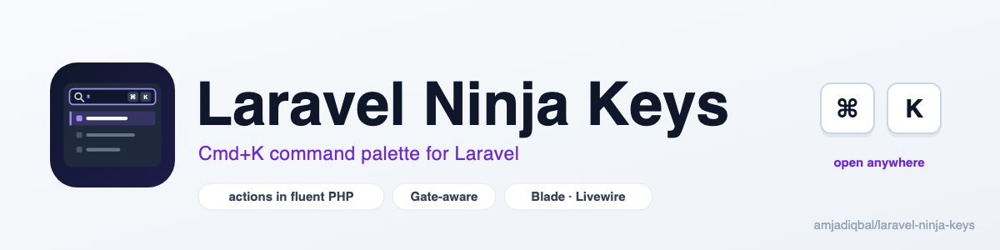
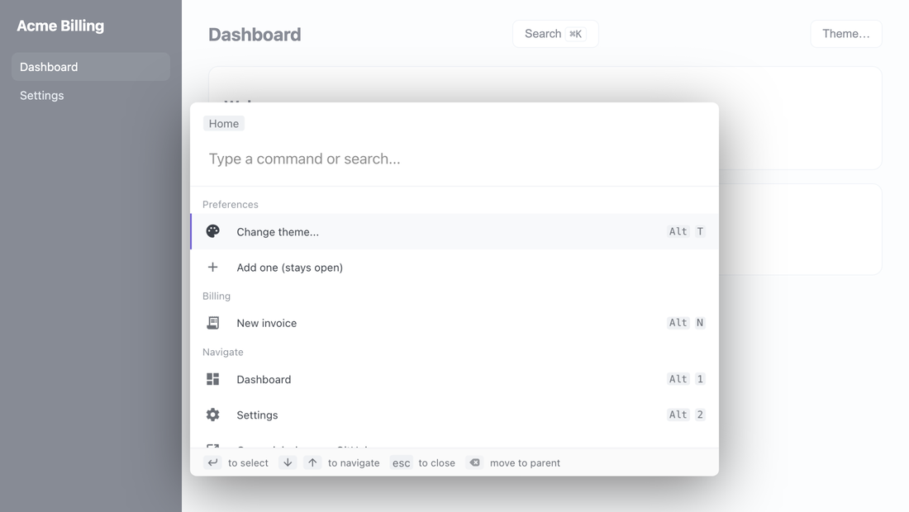

<p align="center">
  <picture>
    <source media="(prefers-color-scheme: dark)" srcset="art/banner-dark.png">
    
  </picture>
</p>

# Laravel Ninja Keys: a Cmd+K command palette for Laravel

Add a keyboard-first **Cmd+K / Ctrl+K command palette** to any Laravel app. Build the actions in PHP,
hide the ones a user may not use with your Gate abilities, and render the
[ninja-keys](https://github.com/ssleptsov/ninja-keys) web component with one Blade tag. Works with Blade,
Livewire (including `wire:navigate`) and Alpine. No JavaScript to write, no npm build step.

[](https://packagist.org/packages/amjadiqbal/laravel-ninja-keys)
[](https://packagist.org/packages/amjadiqbal/laravel-ninja-keys)
[](LICENSE.md)

<p align="center">
  
</p>

```php
// app/Providers/AppServiceProvider.php
use AmjadIqbal\NinjaKeys\Facades\NinjaKeys;
use AmjadIqbal\NinjaKeys\Manager;

NinjaKeys::define(function (Manager $palette) {
    $palette->addAction('dashboard')->title('Dashboard')->mdIcon('dashboard')->route('dashboard')->hotkey('alt+1');
    $palette->addAction('invoices')->title('Invoices')->mdIcon('receipt_long')->route('invoices.index');
    $palette->addAction('users')->title('Manage users')->mdIcon('group')->route('users.index')->can('manage-users');
});
```

```blade
{{-- resources/views/layouts/app.blade.php, before </body> --}}
<x-ninja-keys />
```

Press <kbd>Cmd</kbd>+<kbd>K</kbd> (or <kbd>Ctrl</kbd>+<kbd>K</kbd>) and type.

Docs and demo: https://amjad.com.pk/laravel/packages/laravel-ninja-keys

## Why this package

[ninja-keys](https://github.com/ssleptsov/ninja-keys) is a small, framework-free command palette web
component (about 11,000 npm downloads a week). Dropping it into a Laravel app by hand means writing a
script per layout, building the action list in JavaScript, and remembering which actions each user is
allowed to see. This package does those parts:

- **Actions in PHP.** A fluent builder with ninja-keys' own field names, plus `route()` and `href()` so
  navigation actions need no JavaScript at all.
- **Permission-aware.** `->can('manage-users')` runs your Gate abilities on the server, so actions a user
  may not use are never sent to the browser, and neither are their sub-actions.
- **Per-user at render time.** `NinjaKeys::define()` callbacks run when the palette renders, so they can
  use `auth()->user()`, the current route and the request. Safe under Octane.
- **Livewire-ready.** Survives `wire:navigate` without duplicate shortcuts, and can navigate with
  `Livewire.navigate()` in SPA mode.
- **Pinned and self-hosted by default.** ninja-keys 1.2.2 ships inside the package as one ES module with
  its exact Lit 2 and hotkeys-js versions, published to `public/vendor/ninja-keys` by Laravel's usual
  `laravel-assets` step. No third-party script requests unless you choose the CDN.
- **Works around three ninja-keys bugs.** String handlers no longer throw `handler is not a function`,
  nested (tree) actions no longer pull the root actions after them into their submenu, and typing `(` or
  `[` in the search box no longer throws an error on every keystroke.

## Requirements

- PHP 8.3+
- Laravel 12 or 13
- ninja-keys 1.2.2 is bundled; nothing to install with npm
- Optional: Livewire (tested with 4.4.7)

## Installation

```bash
composer require amjadiqbal/laravel-ninja-keys
```

The service provider and the `NinjaKeys` facade are auto-discovered. The JavaScript bundle is published to
`public/vendor/ninja-keys/ninja-keys.js` automatically on `composer update`, because a default Laravel
app runs `vendor:publish --tag=laravel-assets` after every update. If your app does not, publish it once:

```bash
php artisan vendor:publish --tag=ninja-keys-assets
```

Until the bundle is published the palette loads ninja-keys from jsDelivr instead, so it works either way.
`php artisan about` shows the installed version and which script source is configured.

## Usage

### Render the palette

Put the component once in your main layout, before `</body>`:

```blade
<x-ninja-keys />

{{-- or as a directive --}}
@ninjaKeys
```

Override any config option for one page with an attribute:

```blade
<x-ninja-keys placeholder="Jump to..." theme="dark" open-hotkey="ctrl+j" />
<x-ninja-keys :config="['hideBreadcrumbs' => true, 'noFooter' => true]" />
```

Any element with `data-ninja-keys-open` opens the palette on click, optionally straight into a submenu:

```blade
<button data-ninja-keys-open>Search <kbd>⌘K</kbd></button>
<button data-ninja-keys-open="theme">Change theme…</button>
```

### Register actions

Register actions anywhere before the view renders: in a controller for page-specific actions, or with
`define()` in a service provider for the global ones.

```php
use AmjadIqbal\NinjaKeys\Facades\NinjaKeys;

NinjaKeys::addAction('new-invoice')
    ->title('New invoice')
    ->section('Billing')              // group heading
    ->mdIcon('receipt_long')          // Material Icons name, or ->icon('<svg ...>')
    ->keywords('bill charge create')  // extra search terms
    ->hotkey('alt+n')                 // works even while the palette is closed
    ->route('invoices.create');       // or ->href('/invoices/create'), ->href($url, '_blank')
```

Plain arrays work too, in ninja-keys' own shape:

```php
NinjaKeys::addActions([
    ['id' => 'help', 'title' => 'Help center', 'mdIcon' => 'help', 'href' => 'https://help.example.com', 'target' => '_blank'],
]);
```

`has()`, `forget()` and `clear()` let a page remove or replace global actions.

### Submenus

Use either flat data with `parent` and `children` ids, or nested arrays. Both reach the browser flat.

```php
NinjaKeys::addAction('theme')->title('Change theme…')->mdIcon('palette')->children(['theme-light', 'theme-dark']);
NinjaKeys::addAction('theme-light')->title('Light')->parent('theme')->handler('setLightTheme');
NinjaKeys::addAction('theme-dark')->title('Dark')->parent('theme')->handler('setDarkTheme');

// or nested
NinjaKeys::addActions([
    ['id' => 'theme', 'title' => 'Change theme…', 'children' => [
        ['id' => 'theme-light', 'title' => 'Light', 'handler' => 'setLightTheme'],
        ['id' => 'theme-dark', 'title' => 'Dark', 'handler' => 'setDarkTheme'],
    ]],
]);
```

### JavaScript handlers

`handler()` names a global function. It receives the action; return `{ keepOpen: true }` to keep the
palette open.

```html
<script>
  window.setDarkTheme = (action) => document.documentElement.classList.add('dark');
  window.addToCounter = () => { counter++; return { keepOpen: true }; };
</script>
```

### Only show what the user may do

```php
Gate::define('manage-users', fn (User $user) => $user->is_admin);

NinjaKeys::addAction('users')->title('Users')->can('manage-users')->children(['invite']);
NinjaKeys::addAction('invite')->title('Invite a user')->parent('users')->route('users.invite');

// visible when any ability passes
NinjaKeys::addAction('reports')->title('Reports')->can(['view-reports', 'manage-users']);
```

Hidden actions and their sub-actions are removed on the server; they never appear in the page source.

### Per-user and global actions with define()

`define()` callbacks are stored once and run every time the palette renders, with the request, the
logged-in user and route helpers available:

```php
NinjaKeys::define(function (Manager $palette) {
    foreach (auth()->user()?->teams ?? [] as $team) {
        $palette->addAction("team-{$team->id}")->title("Switch to {$team->name}")
            ->section('Teams')->route('teams.switch', $team);
    }
});
```

Actions added with `addAction()` during a request belong to that request only (the manager is scoped, so
Octane workers start every request clean). `define()` is the place for actions every page should have.

### Livewire

The palette keeps working across `wire:navigate`: the new page's palette replaces the old one, and the old
page's action shortcuts are removed, so they never fire twice or on the wrong page. To make `href()` and
`route()` actions navigate with `Livewire.navigate()` instead of a full page load:

```php
// config/ninja-keys.php
'livewire_navigate' => true,
```

### Events

Name global functions in the config to hear what the palette does:

```php
'onOpen' => 'paletteOpened',     // ({ parent })
'onChange' => 'paletteSearched', // ({ search, actions })
'onSelected' => 'actionChosen',  // ({ search, action })
```

The element's own `change` and `selected` DOM events bubble too, so `document.addEventListener('selected', ...)`
works as well.

### Styling

`theme` is `auto` (follows `prefers-color-scheme`), `light` or `dark`. Everything else is ninja-keys' CSS
variables and shadow parts:

```css
ninja-keys {
  --ninja-width: 640px;
  --ninja-accent-color: #6d28d9;
  --ninja-selected-background: #f5f3ff;
}
ninja-keys::part(ninja-action) { border-radius: 8px; }
```

Parts: `actions-list`, `ninja-action`, `ninja-selected`, `ninja-icon`, `ninja-input`, `ninja-input-wrapper`.

## Configuration

```bash
php artisan vendor:publish --tag=ninja-keys-config
```

| Key | Default | |
|---|---|---|
| `script` | `local` | `local` (bundled, published file), `cdn` (jsDelivr) or `null` (you `import 'ninja-keys'` in Vite). Env: `NINJA_KEYS_SCRIPT` |
| `cdn_url` | jsDelivr `ninja-keys@1.2.2/+esm` | |
| `asset_url` | `/vendor/ninja-keys/ninja-keys.js` | where the bundle is published |
| `material_icons_url` | Google Fonts Material Icons | `null` if you only use `icon()` or no icons |
| `placeholder` | `Type a command or search...` | |
| `openHotkey` | `cmd+k,ctrl+k` | hotkeys-js syntax |
| `navigationUpHotkey`, `navigationDownHotkey`, `closeHotkey`, `goBackHotkey`, `selectHotkey` | ninja-keys defaults | |
| `disableHotkeys` | `false` | don't register action hotkeys |
| `hideBreadcrumbs`, `hotKeysJoinedView`, `noAutoLoadMdIcons`, `noFooter` | `false` | |
| `theme` | `auto` | `auto`, `light`, `dark` |
| `livewire_navigate` | `false` | |
| `onOpen`, `onChange`, `onSelected` | `null` | global function names |

The view is publishable with `--tag=ninja-keys-views`. When you use a CSP nonce through `Vite::useCspNonce()`,
both scripts carry it.

## About ninja-keys and its maintenance

ninja-keys' last release is 1.2.2 (July 2022). It still works in current browsers and is still downloaded
about 11,000 times a week, but upstream bugs are not being fixed. This package copes with that by:

- pinning 1.2.2 and bundling it with the exact dependency versions it was built for (the CDN builds pull
  the latest lit-html 3 next to Lit 2);
- working around the three bugs that affect normal use (string handlers, tree data, regex characters in
  the search box);
- keeping the browser side small: everything specific to Laravel lives in PHP and one short bridge script,
  so moving to a maintained palette later would not change your action definitions.

## Upgrading from 0.x (dev-main)

- Requires PHP 8.3 and Laravel 12 or 13.
- Config is published with `--tag=ninja-keys-config` (was `config`). `use_cdn` and `asset_path` became
  `script` and `asset_url`; `hotKeys`, `searchPlaceholder` and `noHeader` were removed.
- Handlers now receive the action (ninja-keys' own convention) instead of `{ search, action }`; use
  `onSelected` for the latter.
- `@ninjaKeysScripts` still works; `<x-ninja-keys />` and `@ninjaKeys` are the new names.

## Testing

```bash
composer test
scripts/ci-local.sh   # every PHP 8.3–8.5 × Laravel 12/13 combination, Pint and PHPStan
```

## Need this built into your app, or something custom?

I build Laravel packages, admin panels and Livewire features for teams. If you'd like a command palette
designed around your app's real workflows, or need something this package doesn't do,
[get in touch](https://amjad.com.pk/contact?utm_source=github&utm_medium=readme&utm_campaign=laravel-ninja-keys).

## Support

- 🐛 **Bug or feature request**: [open an issue](https://github.com/amjadiqbal/laravel-ninja-keys/issues)
- 🔒 **Security issue**: please report privately via GitHub's security tab

## Need this customised, or something built?

I'm available for custom development, package integration, and technical consulting.

[](https://www.upwork.com/freelancers/amjadkhatri)

## More packages

Part of a family of open-source packages. See [all of them](https://github.com/amjadiqbal?tab=repositories).

| | |
|---|---|
| [laravel-driver-js](https://github.com/amjadiqbal/laravel-driver-js) | Product tours and onboarding for Laravel |
| [kiln](https://github.com/amjadiqbal/kiln) | Deploy-time OPcache control for Laravel |
| [laravel-tiptap](https://github.com/amjadiqbal/laravel-tiptap) | Tiptap editor for Laravel |
| [laravel-rough-notation](https://github.com/amjadiqbal/laravel-rough-notation) | Hand-drawn highlights and annotations for Blade |

## Credits

- [ninja-keys](https://github.com/ssleptsov/ninja-keys) by Serhii Slieptsov (MIT), which does all the work
  in the browser, with [Lit](https://lit.dev) (BSD-3-Clause), [hotkeys-js](https://github.com/jaywcjlove/hotkeys-js)
  (MIT) and [@material/mwc-icon](https://github.com/material-components/material-web) (Apache-2.0), all
  included in the bundled file. This package is an independent wrapper and is not affiliated with ninja-keys.
- [Amjad Iqbal](https://amjad.com.pk)

## License

MIT. See [LICENSE.md](LICENSE.md).
